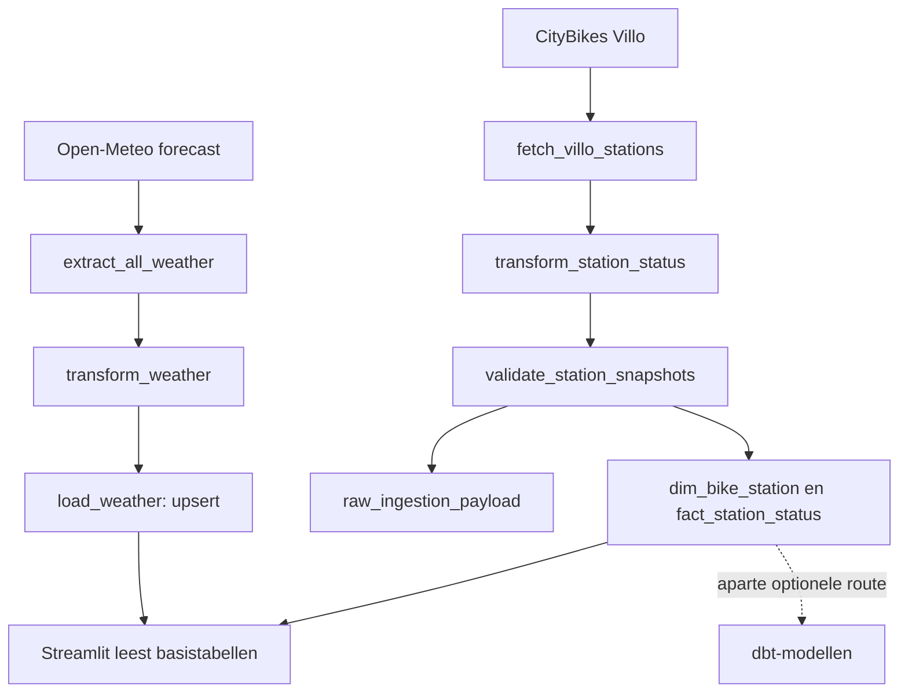

# Van weer en fietsen tot dashboard

[Leerroute](README.md) · [Oefenen](oefeningen.md)

## 1. De zakelijke vraag

“Welke Brusselse fietsstations zijn leeg of vol, en welke weerscontext zien we?”
Een planner kan hiermee een onderzoek naar herverdeling beginnen. De data bewijzen
niet hoeveel ritten zijn gemaakt of waarom iemand een fiets nam. De vraagscore
is een zelfgekozen rekenregel, geen getraind model en geen gemeten vraag.

## 2. De werkelijke route

Lees [flow.py](../../src/mobility_etl/flow.py) van boven naar beneden bij
`mobility_weather_etl()`. Eerst wordt weer geladen; pas daarna worden stations
opgehaald, gecontroleerd en geladen. Het diagram toont de gegevensrelaties;
deze uitvoering is niet één gezamenlijke databasetransactie.

## 3. Eén weersrecord volgen

In [extract.py](../../src/mobility_etl/extract.py) vraagt `fetch_weather()`
uurvoorspellingen op. De response bevat lijsten met tijden en waarden. De code
combineert corresponderende posities tot dictionaries, met plaatsnaam en ophaaltijd.

Voorbeeldinvoer voor de transformatie:

| city | observed_at | precipitation_mm | temperature_c |
|---|---|---:|---:|
| Brussels | 2026-10-11T08:00 | 1 | 12 |

De volledige invoer bevat ook `weather_code` en `extracted_at`. In
[transform.py](../../src/mobility_etl/transform.py) gebeurt dit:

1. Maak een tabel in geheugen.
2. Stop als er geen records zijn.
3. Zet tekst om naar datums; `extracted_at` wordt UTC.
4. Houd bij dezelfde `(city, observed_at)` de laatste **invoerrij** over.
5. Leid regen, weekdag en uur af.
6. Bereken `100 + spitsbonus − regenstraf` en kies de uitvoerkolommen.

Om 08:00 is de bonus 20; bij 1 mm regen is de straf 12. De score is **108**.
Regenstraf is maximaal 55. De code begrenst de eindscore ook onderaan op 20.
Bij niet-negatieve regen en deze formule wordt die ondergrens niet bereikt:
buiten de spits is de kleinste score al 45. Dit is een goed voorbeeld van
code lezen in plaats van iedere regel kritiekloos betekenis toeschrijven.

Let op: `observed_at` is hier de **geldigheidstijd van een weersvoorspelling**,
niet noodzakelijk een observatie. Deze tijd blijft zonder tijdzone in de
database; stationsmomenten zijn wel UTC. Rond zomer-/wintertijd vraagt dat extra
zorg. `keep="last"` betekent evenmin automatisch “meest recent opgehaald” als
de invoer niet in die volgorde staat.

## 4. Waarom weer wordt bijgewerkt

Open [load.py](../../src/mobility_etl/load.py), `load_weather()`.
De sleutel is `(city, observed_at)`. De code schrijft eerst een tijdelijke
stagingtabel en doet daarna een insert met conflict-update.

Een nieuwe voorspelling voor Brussels 08:00 vervangt de eerdere waarden voor
diezelfde sleutel. Je bewaart zo de huidige verwachting per uur, **niet alle
opeenvolgende versies van de weersvoorspelling**. `engine.begin()` begrenst de
transactie voor deze load. Het teruggegeven aantal is de lengte van de invoer;
het onderscheidt geen nieuwe van bijgewerkte rijen.

## 5. Eén fietsstation volgen

`fetch_villo_stations()` vertaalt API-velden naar vaste namen. `free_bikes` wordt
`available_bikes`, `empty_slots` wordt `available_docks`. `snapshot_at` is het
ophaalmoment; `source_updated_at` komt uit de bron. De ruwe response wordt ook
teruggegeven om later te bewaren.

Neem station A met capaciteit 10, 2 fietsen, 8 vrije plaatsen en beide
dienstvlaggen aan. De transformatie berekent **20%** bezetting en status `healthy`.
Daarna ontstaan twee tabellen:

| Tabel | Grain | Gedrag |
|---|---|---|
| `dim_bike_station` | Eén rij per station | Naam, locatie en capaciteit worden bijgewerkt |
| `fact_station_status` | Eén rij per station en snapshotmoment | Nieuwe momenten worden toegevoegd |

Station A om 08:00 met 2 fietsen en om 09:00 met 0 fietsen hoort twee feitrijen
te krijgen. Dezelfde snapshot opnieuw laden voegt door de conflictsleutel geen
extra rij toe. Een geheel nieuwe extractie krijgt een nieuw ophaalmoment en is
daarom een nieuwe snapshot.

De statusregels worden achtereenvolgens toegepast: healthy → empty bij nul
fietsen → full bij nul vrije plaatsen → unavailable als huren of terugbrengen
niet kan. De laatste passende toekenning wint. Bij nul fietsen én nul plaatsen
maar actieve dienstverlening staat dus `full`, niet `empty`.

Ontbrekende numerieke waarden worden nu vaak nul. Dat is een gemak in de code,
maar verbergt het verschil tussen “niet aangeleverd” en “werkelijk nul”.
Capaciteit nul resulteert in 0% bezetting, niet in een aparte onbekend-status.

## 6. Wat de kwaliteitspoort controleert

[quality.py](../../src/mobility_etl/quality.py) controleert minimumaantal
stations, negatieve beschikbaarheidswaarden en dubbele snapshots. Een optionele
versheidscontrole vergelijkt de **nieuwste** niet-lege brontijd met nu.

Daaruit volgen beperkingen die je moet kunnen uitleggen:

- Eén verse rij kan oude andere stations maskeren.
- Als alle brontijden ontbreken, blokkeert deze versheidscontrole niet.
- De grens is alleen actief als de configuratiewaarde groter dan nul is.
- Het is geen complete controle op capaciteit, alle verplichte velden of
  weerswaarden.
- De ruwe stationsresponse wordt pas na geslaagde validatie opgeslagen; een
  afgekeurde response wordt via deze route dus niet gearchiveerd.

## 7. Van database naar beeld

[dashboard/app.py](../../dashboard/app.py) leest feitrijen en koppelt er
stationscontext aan. Daarna kiest het de rijen met het globaal nieuwste
`snapshot_at`. Dit is de laatste batch, niet noodzakelijk de laatste bekende
rij van ieder individueel station. De kaart, tellingen en ranglijst gebruiken
deze selectie. De weersgrafiek gebruikt de Brusselse voorspellingen.

De datafunctie heeft een cacheduur van 300 seconden. Een succesvolle nieuwe
load hoeft daardoor niet onmiddellijk op het scherm zichtbaar te zijn.
Het dashboard leest de dbt-marts niet. Je hoeft dbt dus niet te laten draaien
om te verklaren hoe deze specifieke kaart wordt berekend.

## 8. Wat een groene workflow niet vertelt

Lees [scheduled-pipeline.yml](../../.github/workflows/scheduled-pipeline.yml).
Bij ontbrekend secret meldt de workflow `ETL skipped` en eindigt hij succesvol.
Dat is geen bewijs van nieuwe data. Vergelijk runlog, laatste snapshot en
aantallen. De weers-extractietaak heeft drie retries, de weers-loadtaak twee;
de stationsophaling is in deze flow geen taak met dezelfde retry-instelling.

`etl_run_audit` is gedefinieerd maar wordt hier niet gevuld. Noem die dus geen
werkend volledig monitoringsysteem. De optionele dbt-route verdient een aparte
uitvoeringscontrole: bijvoorbeeld `SELECT * EXCLUDE` in het stationsmart is geen
standaard PostgreSQL-projectie. Aanwezigheid van dat bestand bewijst geen geslaagde
dbt-run op PostgreSQL.

## 9. Een storing onderzoeken

Symptoom: weer is nieuw, fietsstations blijven oud.

1. Zoek de run en de laatste geslaagde stap.
2. Controleer afzonderlijk weers- en stationsmomenten in de database.
3. Controleer bronresponse, kwaliteitsfout en configuratie zonder secrets te tonen.
4. Herinner je dat weer al gecommit kan zijn vóór de stationsstap faalt.
5. Bepaal of je dezelfde opgeslagen invoer herlaadt of een nieuwe snapshot ophaalt.
6. Controleer aantallen en tijdstippen na herstel; vernieuw zo nodig de cache.

## 10. Verbeteringen als leeropdracht

Deze punten zijn **niet door deze documentatie geïmplementeerd**:

- Laat de versheidscontrole ieder station of een afgesproken percentage toetsen.
- Bewaar mislukte ruwe responses apart met een foutreden.
- Vul het auditregister met begin/einde, status, aantallen en codeversie.
- Ontwerp hoe consumenten met een gedeeltelijk geslaagde run omgaan.
- Meet eerst hoeveel historie het dashboard ophaalt; overweeg daarna een query
  die alleen de benodigde laatste rijen leest.
- Bewaar stationsattributen historisch als oude capaciteit belangrijk is.

**Je eigen uitleg:** “Ik combineer weersvoorspellingen met stationssnapshots.
Weer wordt per plaats en uur bijgewerkt; stationstoestanden worden per meetmoment
bewaard. Het dashboard leest de basistabellen. De vraagscore is een heuristiek;
versheid en gedeeltelijke runs vragen nog verdere controle.” Leg daarna iedere
zin met een codebestand uit.
